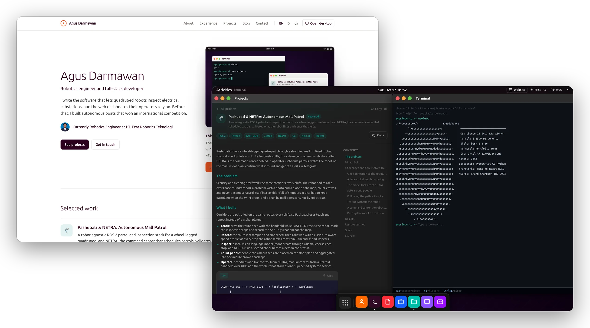
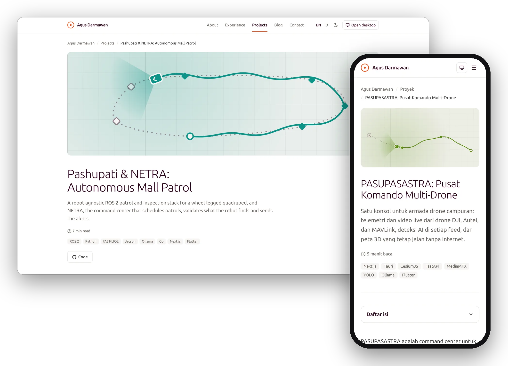
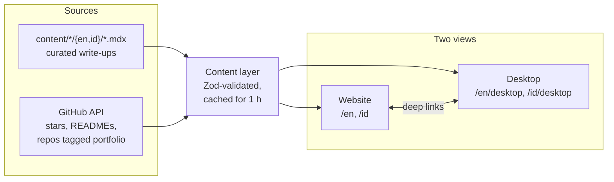

<div align="center">

# agus-darmawan.com

**The portfolio of Agus Darmawan, in two views: a fast website that people and search engines can read, and the same portfolio as an Ubuntu desktop you can actually use.**

[](https://github.com/agus-darmawan/agus-darmawan.com/actions/workflows/ci.yml)
[](https://nextjs.org/)
[](https://react.dev/)
[](https://www.typescriptlang.org/)
[](https://tailwindcss.com/)

[**Website**](https://www.agus-darmawan.com) &nbsp;&middot;&nbsp; [**Desktop**](https://www.agus-darmawan.com/en/desktop) &nbsp;&middot;&nbsp; [Projects](https://www.agus-darmawan.com/en/projects) &nbsp;&middot;&nbsp; [Bahasa Indonesia](https://www.agus-darmawan.com/id)



</div>

---

## Two views, one portfolio

| | Website | Desktop |
|---|---|---|
| Lives at | `/en`, `/id` (the default) | `/en/desktop`, `/id/desktop` |
| Made for | recruiters, phones and search engines | anyone who wants to poke around |
| Feels like | an editorial site: pages, a table of contents, fast first paint | GNOME on Ubuntu 22.04: windows, a dock, a terminal |
| Rendered | statically, revalidated every hour | in the browser, on top of the same data |

Both read from one content layer, in English and Indonesian. Open a project on the website, switch to the desktop, and it opens in the Projects window; go back, and you land on the page for the window in front. The bare domain reopens whichever view you used last.

## Highlights

- **One content layer**: projects and posts are Markdown files with Zod-validated frontmatter, enriched with live GitHub data. Public repos tagged `portfolio` show up on their own, with their README as the write-up.
- **A desktop that behaves**: a store-driven window manager with snapping, minimize without losing state, an error boundary per window, a command palette (`Ctrl+K`) and a terminal with Tab completion, `man agus` and a working vim.
- **Easy to find**: a static page per project and post in both languages, canonical URLs with hreflang, JSON-LD (`Person`, `ProfilePage`, `BlogPosting`, `SoftwareSourceCode`), a social card per page and a sitemap with alternates.
- **The small things**: dark mode, Spotify now playing, a contact form behind Turnstile, a resume viewer, Sentry, Cloudflare Web Analytics.
- **Guarded**: Biome, knip, TypeScript and Vitest on every push, then Playwright against the production build. Dependabot updates merge themselves once CI passes.

## Project write-ups

Every curated project page has the same shape: the problem, what was built, the challenges and how they were solved, results, lessons learned, the stack and my role. They are written in both languages and read well on a phone.



## How it fits together



GitHub is optional at every step: if the API is down or rate-limited, pages render from the Markdown alone, and a repo that is missing or private is never linked. `proxy.ts` handles the locale and sends the bare domain to the view used last.

## Quick start

```bash
git clone https://github.com/agus-darmawan/agus-darmawan.com.git
cd agus-darmawan.com
pnpm install
cp .env.example .env.local   # every variable is optional
pnpm dev
```

## Adding a project or post

Everything lives in `content/` and is loaded by `src/lib/content`. No TypeScript or translation files to touch.

### Zero code: tag a GitHub repo

Add the topic **`portfolio`** to a public repo. It appears within an hour, with its README as the write-up. More topics:

| Topic | Effect |
|---|---|
| `featured` | Pinned to the top |
| `robotics`, `ros`, `ros2`, `drone`, `embedded`, `slam` | Category: Robotics |
| `research`, `paper`, `machine-learning`, `deep-learning` | Category: Research |
| anything else | Shown as a tag; category: Web |

### Curated: write it in Markdown

`content/projects/en/<slug>.mdx`

```mdx
---
title: "Pashupati & NETRA: Autonomous Mall Patrol"
description: "One sentence, up to 300 characters, used for cards, meta tags and social cards."
category: robotics        # web | robotics | research
featured: true
order: 1                  # lower comes first
emoji: "🦿"
color: "#0d9488"
tags: ["ROS 2", "Python", "FAST-LIO2"]
repo: "DarmawanRobotics/Pashupati"   # optional: live stars, hidden if private
demo: "https://example.com"          # optional
---

The body in Markdown. Don't repeat the title as an H1; the page renders it.
```

`content/projects/id/<slug>.mdx` needs only `title`, `description` and the body; everything else comes from `en`, and a missing translation falls back to English. Posts work the same way under `content/blog/`, with a required `date`. Add `draft: true` to hide either. A typo in the frontmatter fails the build and names the file.

## Environment variables

See [`.env.example`](.env.example). Nothing is required; a missing integration simply switches its feature off.

| Variable | Feature |
|---|---|
| `SPOTIFY_CLIENT_ID` / `SECRET` / `REFRESH_TOKEN` | Now-playing widget |
| `NEXT_PUBLIC_SPOTIFY_WORKER_URL` | Use the Cloudflare Worker instead of `/api/spotify` |
| `SMTP_*`, `CONTACT_EMAIL` | Contact form delivery (logged in development otherwise) |
| `NEXT_PUBLIC_TURNSTILE_SITE_KEY`, `TURNSTILE_SECRET_KEY` | Bot protection |
| `GITHUB_TOKEN` | GitHub API at 5,000 instead of 60 requests an hour (recommended in production) |
| `NEXT_PUBLIC_APP_URL` | Canonical base URL (defaults to `https://www.agus-darmawan.com`) |
| `NEXT_PUBLIC_GOOGLE_SITE_VERIFICATION` | Search Console ownership tag |
| `NEXT_PUBLIC_CONTENT_URL` | R2 CDN for the resume PDFs |
| `NEXT_PUBLIC_SENTRY_DSN`, `SENTRY_AUTH_TOKEN` | Error tracking |
| `CF_ACCOUNT_ID`, `CF_SITE_TAG`, `CF_API_TOKEN` | Visitor counter in the terminal |

## Scripts

```bash
pnpm dev          # development server
pnpm build        # production build (standalone output)
pnpm test:run     # unit tests: parser, highlighter, content loader, GitHub client, terminal
pnpm test:e2e     # Playwright against the standalone build (run pnpm build first)
pnpm type-check   # tsc --noEmit
pnpm lint         # Biome
pnpm knip         # unused files, exports and dependencies
pnpm analyze      # bundle analyzer
```

## CI and dependency updates

Every push runs two jobs: **Lint, types, unit tests**, then **Build + end-to-end**, which builds the standalone server and runs the Playwright suite against it (window manager, terminal, SEO, the website and a phone layout).

Dependabot ([`.github/dependabot.yml`](.github/dependabot.yml)) opens pull requests every Monday, with a cooldown so brand-new releases age for a few days first. Patch and minor updates, and GitHub Actions updates, merge themselves once both jobs pass ([`dependabot-auto-merge.yml`](.github/workflows/dependabot-auto-merge.yml)); major updates wait for a review. One-time repository setup:

1. **Settings, General, Pull Requests**: enable *Allow auto-merge*.
2. **Settings, Rules, Rulesets**: a ruleset for `main` that requires a pull request and both status checks. Add *Repository admin* as a bypass actor to keep pushing to `main` directly.

## Docker

```bash
docker build -t agus-darmawan.com .
docker run -p 3000:3000 --env-file .env.local agus-darmawan.com
```

The image runs Next's standalone output on distroless Node 22.

## Structure

```text
content/
  projects/{en,id}/*.mdx    project write-ups (frontmatter + Markdown)
  blog/{en,id}/*.mdx        posts
  resume/                   PDFs (synced to R2)
docs/images/                README images
src/
  app/[locale]/             the website: home, about, experience, projects, blog, contact
  app/[locale]/desktop/     the desktop (noindex: same content as the website)
  app/api/                  contact, Spotify, visitors, content bodies
  components/
    content/                one list + detail implementation behind Projects and Blog
    markdown/               Markdown renderer, code highlighting, table of contents
    seo/                    JSON-LD and route helpers for projects and posts
  config/site.ts            identity, URLs and socials in one place
  features/                 desktop apps: about, blog, projects, terminal, ...
  features/site/            the website: shell, header, footer, pages, home preview
  lib/
    content/                loader, GitHub client, Zod schema, types
    markdown/               parser and highlighter (pure, tested)
    seo/                    metadata and structured data builders
  store/                    Zustand window manager and content selection
  proxy.ts                  locale routing; the bare domain reopens the view used last
```

## License

MIT © [I Wayan Agus Darmawan](https://www.agus-darmawan.com)
